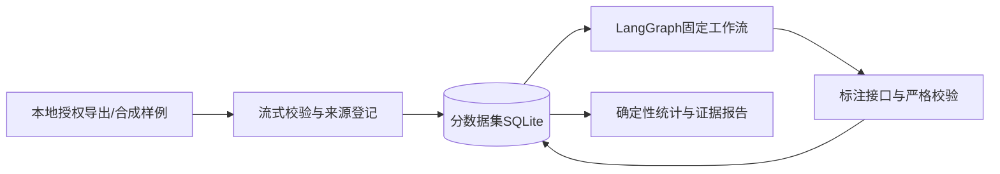

# MetroInsight Agent

[](https://github.com/soso23412/metroinsight-agent/actions/workflows/ci.yml)

面向公共交通服务反馈的证据型 AI 应用：让服务维度、情绪和事件判断回到可检查的数据与原文。

**当前版本：v0.1.0，P1离线工程基线。** 已实现数据导入、严格schema、独立维度/情绪标注接口、SQLite存储、LangGraph固定工作流、失败重跑与合成报告。**自主工具调用、RAG和真实模型效果评测仍在计划中，当前不能按完整Agent成果介绍。**

## 五分钟复现

需要Git与[uv](https://docs.astral.sh/uv/getting-started/installation/)。uv会准备Python和锁定依赖；首次安装需要网络，安装后的演示不需要网络、GPU、API Key或社交平台账号。

```sh
git clone https://github.com/soso23412/metroinsight-agent.git
cd metroinsight-agent
uv sync --locked
uv run --frozen --offline metro-agent demo --offline --output artifacts/demo
```

用浏览器打开生成的 `artifacts/demo/report.html`。同时生成：

- `report.json`：结构化统计、原文引用、版本与局限。
- `demo.sqlite3`：独立演示数据库；重复运行复用已成功标注的内容。

演示包含12条**明确合成**的反馈，覆盖正面、负面、中性、混合情绪、多维度、无关内容和未证实事件候选。规则只接受带synthetic标记的数据，没有调用LLM，不提供真实分类准确率结论。

## 已实现的行为

| 能力 | 可检查的行为 |
| --- | --- |
| 数据规范化 | 小红书JSONL、微博CSV流式导入；每行有成功/重复/拒绝计数 |
| 溯源与版本 | 来源文件SHA-256、行号、原ID、导入器版本和dataset_id |
| 严格schema | 拒绝非法标签、无时区时间、不匹配的证据片段和跨字段冲突 |
| 多维分析 | 相关性、情绪、多个服务维度与事件候选互相独立 |
| 存储隔离 | 数据集+平台+原ID复合主键，不覆盖其他平台内容 |
| 失败重跑 | 失败项显式保存；版本变化后不误用缓存 |
| 数据保护 | 不导入作者profile；剥离URL认证参数；拒绝写入旧格式数据库 |
| 评论粒度 | 评论关联原帖；图片评论与空评论单独标识 |
| 报告 | SQL计算数字，原文可核对；显示维度重叠与分母，无CDN依赖 |

这些是固定workflow的工程能力，后续将成为Agent调用的基础工具。

## 导入自己的授权数据

小红书输入兼容MediaCrawler导出的JSONL。采集工具需另行准备，本仓库不包含爬虫、登录态或原始社媒数据。

```sh
uv run metro-agent ingest --adapter xhs --contents /path/to/contents.jsonl --comments /path/to/comments.jsonl --db artifacts/import/normalized.sqlite3
```

微博CSV至少包含 `微博id` 与 `正文` 两列，或 `content_id` 与 `text` 两列；可包含 `时间`、`点赞数`、`评论数`。使用UTF-8/UTF-8 BOM；原ID作为字符串保存，不假装恢复Excel丢失的精度。

```sh
uv run metro-agent ingest --adapter weibo --contents /path/to/feedback.csv --db artifacts/import/normalized.sqlite3
```

`ingest` 只规范化和落库，不调用模型。缺时间和非法计数以缺失及warning表示，不静默填0。返回码：0表示完成且无拒绝行；2表示部分行被拒绝并输出原因；1表示操作失败。文件级失败会回滚本次导入，原始文件不会被修改。

请选择**新的输出数据库**；导入器拒绝复用历史 `transit.db` 或其他应用的库。公开演示只依赖随包分发的合成数据。

## 开发验证

```sh
uv run --frozen --offline pytest
uv run --frozen --offline ruff check .
uv run --frozen --offline ruff format --check .
uv build
uv run --frozen --offline python scripts/check_public_tree.py
```

测试覆盖坏行对账、图片/空评论、数据版本、跨平台隔离、事务回滚、非法输出、失败重跑、缓存失效、离线禁网、HTML转义、跨工作目录启动和标准库导入。测试临时文件位于项目 `.cache/test-runs/`。

GitHub Actions按Windows/Linux、Python 3.12/3.13矩阵验证。状态以仓库Actions实际结果为准。依赖和哈希见 `uv.lock`，构建后端也固定版本。受限Windows沙箱的临时目录处理见[实施日志](docs/logs/2026-10-16-p1-foundation.md)。

## 架构与目录



```text
src/metro_agent/
├── domain/          内容、评论、标注、证据和导入计数
├── ingestion/       平台适配、规范化、版本化导入
├── storage/         复合主键、事务、标注状态与缓存
├── models/          标注接口与仅限合成数据的离线规则
├── annotation/      LangGraph固定工作流
├── reporting/       SQL统计、证据核对、HTML/JSON报告
└── resources/       随安装包分发的合成样例
tests/               第一方测试
scripts/             公开文件检查
docs/                进度、设计、研究、计划与日志
```

旧原型和数据只在开发者本地 `legacy/` 等目录保留，不影响新包导入或公开复现。

## 后续建设

下一阶段先做数据字典、人工复核规范、去重切分和基线评测，再建设工具调用、证据检索、checkpoint与任务界面。尚未交付的技术不会先写进简历。

| 文档 | 用途 |
| --- | --- |
| [当前进度](docs/STATUS.md) | 已完成、未完成与下一项任务 |
| [实施日志](docs/logs/2026-10-16-p1-foundation.md) | 本轮改动、验证与Git同步 |
| [执行计划](docs/plans/2026-10-16-metro-agent-implementation.md) | 分阶段任务与验收 |
| [架构设计](docs/plans/2026-10-16-metro-agent-design.md) | 目标Agent与技术边界 |
| [岗位调研](docs/research/2026-10-16-agent-internships.md) | 岗位要求与状态限制 |
| [开源学习](docs/research/2026-10-16-github-study.md) | 仓库快照与源码入口 |
| [项目规则](AGENTS.md) | 后续开发约束 |

本项目由Codex辅助开发，原始研究为团队成果。来源与许可见[NOTICE](NOTICE.md)，新版代码采用[MIT](LICENSE)。合成演示、工程测试和真实模型效果严格区分；社媒反馈占比不能直接解释为全体乘客满意率。
