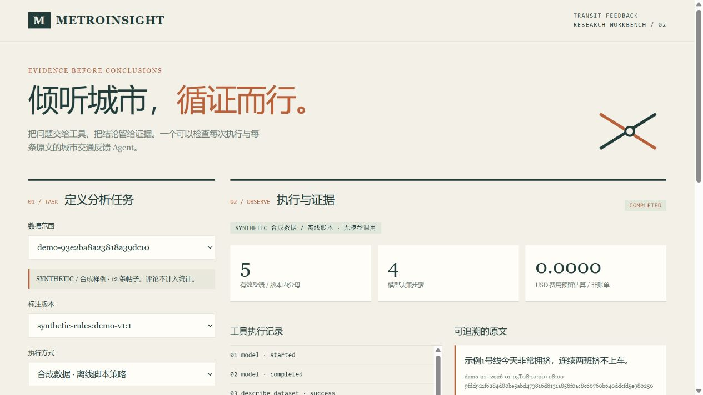
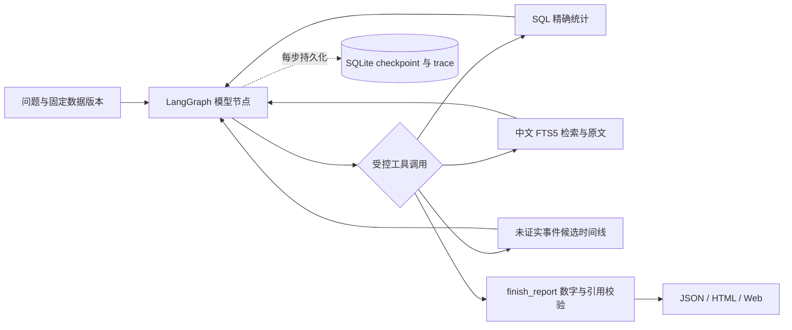

# MetroInsight Agent

[](https://github.com/soso23412/metroinsight-agent/actions/workflows/ci.yml)

面向公共交通社媒反馈的证据型 Agent：**任务 → 工具调用 → 中文检索 → 数字与引用校验 → 报告**。

v0.2.0 已交付可运行的 Agent 工程、模型协议适配器、任务恢复和本地 Web 工作台。默认使用明确标记的合成数据与离线脚本策略，无 API Key、无 GPU、无模型费用。真实模型效果、人工黄金集和盲测尚未完成；本仓库不使用合成成绩冒充业务准确率。



## 五分钟复现

需要 Git 和 [uv](https://docs.astral.sh/uv/getting-started/installation/)。首次安装联网下载锁定依赖，之后以下演示可断网运行。CI 覆盖 Windows/Linux × Python 3.12/3.13。

```sh
git clone https://github.com/soso23412/metroinsight-agent.git
cd metroinsight-agent
uv sync --locked
uv run --frozen --offline metro-agent serve
```

打开 **http://127.0.0.1:8000**，点击“线路反馈”“事件候选”或“无证据处理”。页面能检查数据范围、工具轨迹、分母、原文和报告 JSON。服务默认仅供本机使用，Ctrl+C 停止。

也可直接运行 CLI：

```sh
uv run --frozen --offline metro-agent analyze --question "分析示例1号线的服务反馈，给出情绪统计和原文证据。" --output artifacts/agent
uv run --frozen --offline metro-agent evaluate --output artifacts/evaluation
```

CLI 返回 run_id；报告在 `artifacts/agent/<run_id>/report.html`，同目录有 report.json 和脱敏运行摘要 run.json。私有 checkpoint 在 runs.sqlite3 中。原 P1 的 `demo --offline` 命令仍保留。

## Agent 如何工作



在线适配器接收模型 function calls，按观察结果继续决策。离线策略只支持演示任务类型，运行同一执行器来验证工程行为；它不是 LLM，也不代表任意自然语言理解能力。

| 能力 | 具体实现与边界 |
| --- | --- |
| 数据接入 | 小红书 JSONL、微博 CSV 流式导入，对账、来源哈希、行号、事务与版本 |
| 标签 | 相关性、情绪、十个服务维度、事件候选独立建模，原文偏移校验 |
| 工具 | describe_dataset、aggregate_feedback、retrieve_evidence、read_evidence、get_event_timeline、finish_report |
| RAG | 中文二元字符/单字切分 + SQLite FTS5/BM25；未使用向量模型 |
| 报告约束 | 数字引用已有 SQL 结果，证据必须来自当前任务已观察集合，并核对原文 |
| 恢复与幂等 | 步骤 checkpoint、结果与游标一致提交、Idempotency-Key、数据/模型变更拒绝恢复 |
| 资源边界 | 步数/时间/token/费用预留；超时不确定请求需复核，不自动重复计费 |
| 交互 | FastAPI、单进程后台任务、本地 Web、状态轮询、SSE 事件游标重放 |
| 验证 | pytest、HTTP 模拟故障、合成任务与检索对照、跨平台 CI、安装包 |

SQL 分母覆盖范围内的全部成功标注帖子；Top-k 原文仅是例证，评论另存不混入分母。服务维度可重叠。事件候选默认未经核实。社媒样本不能代表全体乘客满意率。

## 导入授权数据与人工评测

仓库不包含爬虫、真实原帖、登录状态或历史数据库。使用自己的授权导出文件，选择新的输出库：

```sh
uv run metro-agent ingest --adapter xhs --contents /path/to/contents.jsonl --comments /path/to/comments.jsonl --db artifacts/import/normalized.sqlite3
uv run metro-agent ingest --adapter weibo --contents /path/to/feedback.csv --db artifacts/import/normalized.sqlite3
uv run metro-agent prepare-review --db artifacts/import/normalized.sqlite3 --dataset <导入返回的dataset_id> --output artifacts/review/pending.json
```

微博 CSV 至少包含 `微博id/正文` 或 `content_id/text`；ID 保留字符串，缺失和非法计数不悄悄填0。导入不调用模型。

复核包默认 pending，不自动制造金标。逐条人工复核、补充事件组并冻结切分后，可用 `evaluate --review artifacts/review/reviewed.json` 运行多数类/训练集 TF-IDF centroid 基线，报告 Macro-F1、支持数和混淆矩阵。详见[数据卡](docs/data/data-card.md)、[标注规范](docs/data/annotation-guide.md)。历史 C1–C9 与 0 映射仍待确认，旧预测不当真值。

真实模型的配置、结构化标注和在线分析命令见[运行说明](docs/operations.md)。**当前交付按用户要求未执行付费调用。** 密钥仅通过本机环境变量配置，页面不收集密钥，.env.example 不自动加载。

## 验证与结果

```sh
uv run --frozen --offline pytest
uv run --frozen --offline ruff check .
uv run --frozen --offline ruff format --check .
uv run --frozen --offline metro-agent evaluate --output artifacts/evaluation
uv build
uv run --frozen --offline python scripts/check_public_tree.py
```

当前合成合同包含12个端到端任务和12个检索查询，所有样例公开已知；结果仅用于工程验收，不是正式40题盲测。[验证报告](docs/evaluation/final-report.md)记录实际结果、故障目录与未验证项目。真实分类 F1、真实模型任务成功率、人工引用支持率和费用改善均未给出。

恢复演示、HTTP 接口、费用估算与实际账单的区别见[运行说明](docs/operations.md)。应用是本机研究工作台，尚未验证公网多租户服务或百万条检索；向量检索、OCR、MCP、多 Agent 和 Docker 不是当前已实现能力。

## 代码导航

```text
src/metro_agent/
  ingestion/    原始导出适配与导入对账
  domain/       严格数据与标注 schema
  storage/      版本化内容、评论与标注
  annotation/   合成流程及显式开启的真实模型标注
  models/       Chat Completions 适配器、离线策略
  retrieval/    中文 FTS5 检索
  agent/        工具合同、工具箱、LangGraph、任务 journal
  reporting/    数字/引用校验及 HTML/JSON
  evaluation/   复核、分组、基线与指标
  api/          本地接口及 Web
```

[项目状态](docs/STATUS.md) · [执行计划](docs/plans/2026-10-16-metro-agent-implementation.md) · [工作日志](docs/logs/2026-10-16-agent-delivery.md) · [面试自查](docs/portfolio/interview-notes.md) · [简历证据](docs/portfolio/resume-evidence.md)

## 来源与许可

新版第一方代码使用 MIT，开发包含 AI 辅助。历史团队工作、第三方框架和新版交付分别说明于 [NOTICE](NOTICE.md)；GitHub 仓库不包含 MediaCrawler 本地副本、历史私有数据、模型权重或密钥。合成样例不描述真实人员、城市或事故。[参考项目调研](docs/research/2026-10-16-github-study.md)记录借鉴边界。
