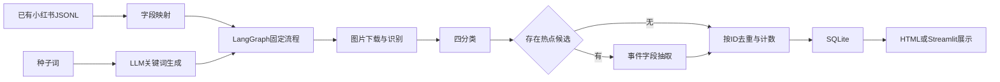

# 项目接手审查

审查日期：2026-10-16。结论：项目同时包含一套旧微博研究资产和一套2026年8月的 LangGraph 原型。值得延续，但尚不足以作为完整 Agent 工程成果写入简历。

## 1 阅读范围与证据

初始审查快照共有24,457个文件，约3.30 GiB，包含刚新增的1个审查脚本；绝大多数是虚拟环境、依赖、浏览器状态和大数据。文件清单并不等于逐个阅读每份第三方安装文件。

本轮完成了以下分层检查：

| 对象 | 覆盖与方法 |
| --- | --- |
| 全部文件 | 路径、字节数、类型索引，未发现枚举错误 |
| 第一方 Python | 21个 `.py` 文件；逐个语法解析，核心逻辑全文审查 |
| 旧文档 | 29份 DOCX/PPTX/PDF/DOC/RAR 记录；可提取文本的文件完成文本索引，关键报告和路线正文阅读 |
| PDF | 共368页文本提取；`事件检测.pdf` 是3页扫描件，另行渲染并查看全部3页 |
| 表格 | 24个 XLSX/CSV 文件，按工作表读取结构、非空行、表头和明确标签列分布 |
| 小红书 | 4个 JSONL 完整解析、ID统计；原帖和评论分别计数 |
| SQLite | 只读连接，完整性、行数、分类、OCR标记、关联孤儿及时间范围检查 |
| 第三方 MediaCrawler | 阅读入口/依赖配置/许可证与数据接口，不对整个第三方仓库逐行审计 |

**明确的例外**：旧 `.doc` 和 `.rar` 仅核对元数据与哈希，未转码或解压；图片、PPT嵌入图和临时文件未逐一作语义识别；PDF文本提取不等于所有论文都完成学术精读；不读取 `.env` 值、浏览器Cookie/profile内容或安装包内部代码。`事件识别/事件识别的基本实现.docx` 为0字节空文件，无法阅读。

机器证据保存在本地的`docs/audit/2026-10-16/{summary.json,smoke.json,inventory.csv}`，这些历史私有数据的审查快照不随公开仓库分发。文本提取保存在本地忽略目录 `.cache/takeover-2026-10-16/`，其中可能含团队信息，不公开。

## 2 文件架构与用途

| 目录/文件 | 实际内容 | 接手处理 |
| --- | --- | --- |
| `方案设计.md` | 旧Agent方案，提出抖音、小红书、RAG、多模态、采集按钮 | 保留并标记历史；不能当实现清单 |
| `platform/` | 20个Python文件、SQLite、关键词JSON、Streamlit与HTML报告 | 作为原型参考，逐项迁移到无冲突包名 |
| `MediaCrawler/` | 第三方爬虫、完整依赖与浏览器状态、JSONL | 保留本地，作为外部可选数据源，不打包成自研代码 |
| `地铁数据预处理/` | 约1.63 GiB，微博CSV、分词与词表 | 原始只读、流式导入；不全量调用LLM |
| `人工打标/`、`数据/` | 分批标注、汇总训练集、事件清单 | 查标注来源、ID、重复、标签定义 |
| `事件识别/` | SVM脚本、事件表和参考文献 | 保留传统方法基线，修复路径与验证流程 |
| `项目说明书/` | Word/PDF报告、21页PPT、10万行预测与情感结果 | 仅作历史产物，不视为新版实验结果 |
| `报名/` | 表格、成员信息、报名文档与压缩包 | 不公开，不能省略旧团队贡献 |
| `舆情/`、`翻译/`、根PDF | 社媒满意度、事件检测、传播和文本图像研究 | 领域背景，不默认纳入RAG公开语料 |
| `wheels/` | 约305 MiB的旧离线安装包，混有不同架构 | 不用于新版依赖锁定，不删原件 |
| `.workbuddy/memory/` | 8月22/23日历史决策与结果 | 对照代码和数据复核，不能自动当成当前事实 |

根目录和 `platform/` 没有项目级依赖清单、锁文件、第一方测试或根README；本轮新增README、规则与审查工具。MediaCrawler自己的 `pyproject.toml`、`uv.lock`、测试不等于本项目已具备这些工程条件。根目录不是Git仓库。

## 3 当前数据实数

| 文件/数据 | 本轮计数 | 能说明什么 |
| --- | ---: | --- |
| `processed_2023.csv` | 1,879,994行 | 保存的微博记录数，不代表独立用户或完成标注 |
| `processed_file.csv` | 1,484,896行 | 另一版本预处理数据，不能与上行直接相加 |
| `地铁数据预处理/predicted_results.csv` | 100,000行 | 历史机器预测 |
| `地铁主题示例数据.csv` | 989行 | 可用于了解旧字段，含作者属性，不能直接公开 |
| `数据/分类训练集.xlsx` | 35,368行 | 34,393条标签为0，其余975条；0的含义需核对 |
| `项目说明书/最终训练集.xlsx` | 35,368行 | 标签分布相同但文件哈希不同，尚未逐行证明完全相同 |
| `人工打标/训练数据 整合版.xlsx` | 10,000行 | 9,729条为0，并有`C9/c9`格式差异 |
| `人工打标/数据整合.xlsx` | 27,155行 | 26,238条为0，存在1条空标签 |
| 事件清单“完整版” | 4,143行 | 事件候选表，不代表4,143个独立真实事件 |
| `项目说明书/情感分析结果.xlsx` | 100,000行 | 无需分析94,510；积极3,187、消极1,644、中性659；属于旧预测 |
| 小红书8月22日 | 40笔记、374评论 | 历史日志曾写276评论，本次以当前文件为准 |
| 小红书8月23日 | 40笔记、197评论 | JSONL均可解析，文件内ID无重复 |
| 当前SQLite | 80内容、571评论 | 无关40、负面30、正面2、热点候选8 |

SQLite `quick_check=ok`，无缺失内容ID或孤儿评论；40条正文含`[图片文字]`。这只能证明已有保存内容，不能证明每张图识别正确。本轮没有联网重新识图。

帖子的发布时间范围是 **2020-11-11 至2026-08-23**，采集文件名中的日期不代表事件发生日期。部分Excel批次第一行就是记录，没有标准表头；审查输出已隐藏这类首行内容，并记录含首行的非空总行数，避免丢掉首条数据。

## 4 已有功能与缺口

| 能力 | 实际状态 |
| --- | --- |
| 统一内容/评论schema | dataclass已实现，但无强校验、追溯和版本 |
| 分类与事件抽取 | 提示词+JSON解析已实现；未建立独立评测 |
| LangGraph路由 | 有固定节点、热点条件路由；没有自主工具选择循环与checkpoint |
| 关键词扩展 | LLM生成+黑名单；输出未接采集器，也未由主入口调用保存函数 |
| 图片OCR | 有Qwen-VL调用和存量文本；默认遍历所有带媒体URL的内容，成本与失败不可观测 |
| 评论分析 | 只规范化和落库，未送入分类/事件管线 |
| RAG | 未实现；没有文档检索、embedding、向量索引或引用生成链路 |
| 采集按钮/API任务服务 | 未实现；MediaCrawler与处理入口仍分开 |
| 报告 | HTML渲染已存在，主要是统计展示，没有任务型分析与证据校验 |
| 工程化 | 缺第一方依赖锁定、评测集、trace、有限重试、成本统计和CI |

## 5 优先修复的问题

| 优先级 | 证据位置 | 问题与后果 | 本轮验证 |
| --- | --- | --- | --- |
| P0 | 根`platform/` | 遮蔽标准库，`platform.system()`不存在；依赖在根目录导入会失败 | 实际导入与PDF库失败复现 |
| P0 | `pipeline/agents/classifier.py` | 非法分类可直接写入，返回confidence/reason未持久化 | FakeLLM探针接受不存在标签并processed=True |
| P0 | `storage/db.py` | 仅以content_id为主键，不同平台相同ID互相覆盖 | 内存库写入2平台只剩1条 |
| P1 | `collectors/xhs_loader.py` | JSON坏行静默丢弃；坏时间戳可抛错中断 | 时间戳ValueError复现 |
| P1 | `web/app.py` | 仍按“日常抱怨”计数和筛选，实际分类已改“负面抱怨” | 源码核对 |
| P1 | `graph.py` | 去重在OCR/分类后，重复内容已产生调用费用；无持久状态/失败恢复 | 源码核对 |
| P1 | `main.py` | 默认硬编码旧日期和工作目录相对路径，可能处理错批次并覆盖旧库 | 源码核对，未执行入口 |
| P1 | `classifier.py`及标签设计 | 事件与情绪互斥，且中性服务描述被定义为负面 | 源码规则核对 |
| P1 | `multimodal.py` | 混用媒体URL、全量下载、失败可能静默；文字直接追加破坏原文边界 | 源码核对 |
| P1 | `schema.py`、`extractor.py` | 注释仍为三分类，抽取事件类型缺“新线开通”；昵称并未真正匿名化 | 源码核对 |
| P1 | 历史SVM脚本 | 硬编码其他电脑路径；先SMOTE再交叉验证，存在折内泄漏风险 | 静态审查，未重训 |

历史报告中的“半监督”“动态情感阈值优化”“工业级”“实时预警”“突破性创新”缺乏当前可复现代码或实验链条支撑。PPT表中SVC指标0.75、8月日志中的90%+都保留为历史表述，不转写为新版模型质量。

## 6 本轮离线验证及限制

运行 `tools/audit_smoke.py`，使用假模型、内存SQLite和内存HTML渲染：3项预期行为通过，3项缺陷探针成功复现。它不是“6项功能测试通过”，更不是分类准确率评测。

原始数据库哈希仍为 `ee96ff059bc0edd5a702e6b83515b6d4003f5c7655a3b9acdd5fe1555b1cab44`；本轮付费模型调用为0，无抓取、登录、Git提交、上传或部署。

收尾重新计算了79份原始文件哈希，均未改变；文档链接检查记录见本地`docs/audit/2026-10-16/verification.json`，公开仓库不提供私有文件哈希清单。

## 7 对原研究资产的取舍

旧研究提供了服务维度、事件清单、词表及传统方法基线，这些是项目的领域优势。扫描件`事件检测.pdf`实际是知识图谱/R-GCN的参考报告节选，不能当成本项目已实现的知识图谱功能。

新版先解决可验证的数据分析与证据引用。问卷融合、逆概率加权、舆情态势预测、知识图谱与视频分析均暂不列为首版承诺；当前缺相应采样信息、可靠真值或独立验证条件。
