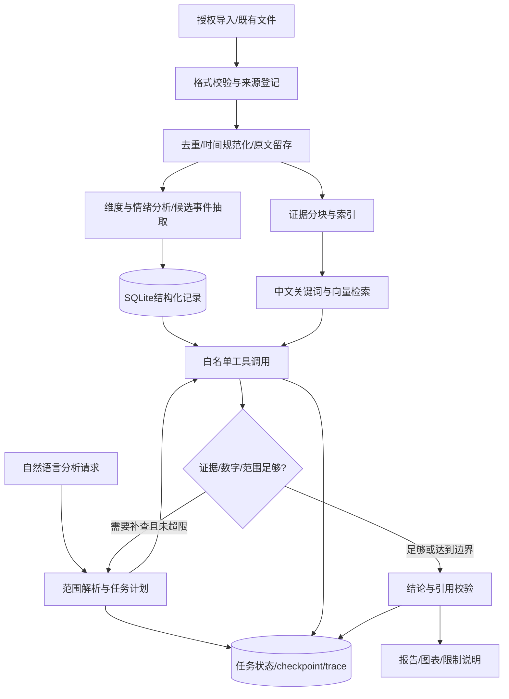

# MetroInsight Agent 产品与架构设计

日期：2026-10-16。状态：基于接手授权形成的默认实施方案，可由用户后续指令调整；本文件描述目标，不代表功能已实现。

## 1 产品定位

构建一个**公共交通服务反馈分析 Agent**。使用者是需要快速了解某批反馈问题的分析人员。输入可以是现有CSV/JSONL导入和自然语言问题，输出是带数字、原文证据、数据范围与不确定性的分析报告。

首版主要支持地铁，保留公交数据兼容；保留旧项目的满意度研究背景，但对外演示以“社媒服务反馈分析”描述结果。当前数据不能支持总体乘客满意度估计或实时运营预测。

核心问题是：从散乱社媒内容中找到有关的服务问题，准确计算、引用并解释，让分析过程可以检查和复现。新增Agent能力围绕这个任务建设。

## 2 三个可演示任务

| 用户任务 | 应执行的工具 | 合格输出 |
| --- | --- | --- |
| 比较某批上海地铁反馈中的拥挤和延误 | 数据范围核对、结构化统计、证据检索 | 明确总样本/有效分母、两类计数及重叠、代表原文、样本限制 |
| 整理某停运候选事件的时间线 | 候选事件查询、证据检索、可选官方材料核查 | 区分发布时间/叙述时间/采集时间；冲突和未证实内容可见 |
| 解释“为什么这条被判负面”，并处理反例 | 读取原文及已有标注、规则检索、重新分析 | 分开维度与情绪；记录异议，人工确认后才能进入金标/回归集 |

演示问题必须使用数据实际覆盖的城市、时间与主题，不能虚构一条不存在的线路或生成假的官方公告来充数。

## 3 首版范围与延后内容

首版必须有：离线导入、schema与标签版本、确定性统计、证据检索、受控工具调用循环、引用校验、持久任务与错误恢复、任务进度页、可复现实验和无需密钥的合成演示。

首版不承诺：常驻爬虫、抖音视频理解、对外自动告警、自动发布、全平台采集、全市满意率、舆情预测、知识图谱、LoRA/SFT/RL训练、通用代码执行、多租户生产平台。它们不是招聘关键词清单中的必做项。

## 4 备选路线与决策

| 路线 | 好处 | 成本与局限 | 决策 |
| --- | --- | --- | --- |
| 有界单Agent+可复用分析工具+LangGraph | 延续现有基础，状态与工具清楚，容易评测和解释 | 需要认真设计工具、证据与失败处理 | **首选** |
| 全面多Agent舆情研究平台 | 可参考BettaFish的分工，覆盖复杂任务 | 费用和上下文传递增加，责任归因难，现有数据不足以证明必要性 | 首版暂缓 |
| Dify/Coze搭建工作流演示 | 原型快，容易展示产品流程 | 难以突出个人工程实现，深度定制与复现受平台约束 | 学习对照，可作后续集成 |

项目的Agent判据：模型能在明确目标和预算下选择结构化工具、依据观察决定是否继续，并对结果作证据校验；固定分类流水线仍称workflow。固定任务直接走确定性流程更可靠时，不强制套LLM规划。

## 5 目标数据流



数据预处理和批量标注是独立可重放任务，不在每次问答时重新OCR或重新分类全部原帖。

## 6 数据模型与分析口径

### 原始、派生和执行记录分开

- `RawContent`：平台、原ID、来源文件哈希、原始文本、URL、采集时间、发布时间、关键词和媒体引用。业务主键是`(platform, content_id)`。
- `Comment`：同样复合主键，关联所属原帖，区分原帖与评论粒度。评论可形成额外分析视图，不能悄悄并入原帖分母。
- `Annotation`：相关性、情绪、多个服务维度、城市/线路/站点、事件候选、证据片段、标注来源、模型/prompt/schema版本。
- `Evidence`：证据ID、原帖/文档ID、片段位置、来源URL、时间、是否合成、可见范围。OCR另存并保留媒体来源，不能覆盖原文。
- `Run/ToolCall/ModelCall`：目标、筛选范围、数据/索引版本、运行状态、错误、摘要、用量、延迟与checkpoint。

社媒URL可能带时效或token；公开产物必须去掉认证参数，私有库也不把链接可访问性当真实性证明。

### 维度正交

建议字段：

```text
relevance: relevant | irrelevant | uncertain
sentiment: positive | neutral | negative | mixed | unknown
service_aspects: 多选服务维度，使用有版本的数据字典
city / line / station: 内容可支持时填写，无法确定时保留unknown
event_candidate: 是否描述可定位事件
event_type / described_event_time: 允许缺失与冲突
verification_status: unverified | corroborated | contradicted | unknown
evidence_spans: 支持判断的原文位置
```

“热点”是聚合后的讨论热度概念，不是单条模型四分类标签。服务体验与事件可同时存在，情绪与维度也不互相替代。旧C1-C9在数据字典中保留映射与歧义，不能直接混并为新标签。

### 满意度与采样偏差

输出“在本批有效服务反馈中，负面条数/占比”，并给出抽样方式及分母。定向负面关键词、平台推荐排序、重复发帖和不表达意见者都会影响样本构成。不得以它推断所有乘客满意率；没有概率样本与充分协变量时也不声称做IPW纠偏。

## 7 工具接口

| 工具 | 参数示例 | 输出与边界 |
| --- | --- | --- |
| `describe_dataset` | dataset_id | 范围、时间、版本、字段与缺失；阻止查询越界 |
| `aggregate_feedback` | city, line, window, aspect, grain | 参数化统计，返回分子分母、重叠、口径及查询ID；不接受任意SQL |
| `retrieve_evidence` | query, filters, k | 返回Evidence对象；限制条数和文本长度，始终执行数据范围过滤 |
| `get_event_timeline` | event_id, window | 按可验证时间排序，缺失时间显式列出 |
| `read_evidence` | evidence_ids | 仅访问本run可见的证据，防跨数据集泄漏 |
| `export_report` | validated_report_id | 只把已校验报告写入项目产物目录，不接受任意路径 |

后续才考虑外部官方资料搜索；网络不可用时从已有证据生成有明确限制的报告。MCP是这些工具的可选暴露方式，核心Python工具不依赖MCP客户端才能运行。

## 8 检索设计

先完成按平台、城市、时间、维度的结构化过滤，再做中文分词的关键词检索。初始小数据可用SQLite FTS5处理分词后的内容；确认运行时包含FTS5，并测试短站名/线路名，避免照搬英文分词设置。

在固定查询集上增加一个本地中文embedding索引，与关键词检索对比；采用RRF等混合排序的前提是召回或支持率有稳定改善。向量索引暂选可本地运行的实现，安装兼容性和模型许可实测后锁定，不能先宣称已经使用FAISS/Chroma。rerank按收益与成本决定是否加入。

数字类问题必须经SQL工具得出全体符合条件记录的统计；检索Top-k只是证据示例，不能用Top-k结果计算总体占比。

## 9 Agent、模型与错误边界

运行状态包含`run_id`、用户目标、dataset_version、允许工具、消息摘要、证据引用、剩余预算和当前阶段。每条run独立，重启后读取checkpoint；数据版本改变时不复用旧结果。

建议初始上限：12个工具决策步骤、每次工具调用30秒、整任务180秒、每个可重试瞬态错误最多重试2次；以上是待实测配置，不是已测性能。全局任务截止时间与费用上限优先于节点重试。

文本模型默认评估现有DeepSeek配置的适用性，视觉模型保留Qwen-VL适配器。真实实现前核对选定模型的tool calling、结构化输出和用量接口；提示词解析不能冒充模型协议层工具调用。密钥读取与请求失败经过脱敏处理，离线模式不读取真实密钥值。

未知标签、输出缺字段、无效时间、过期图片、空检索、模型超时都产生明确状态。证据不足可以结束并说明限制，不生成“已发生”的事实；数字不一致时回到确定性结果修正，不由另一遍自由生成掩盖。

## 10 可观测性、界面与部署

首版采用Python、Pydantic、LangGraph、SQLite、FastAPI和简单Web页面。界面先显示数据范围与样本口径，再显示任务进度、工具结果摘要、原文证据与报告。用户能区分离线合成演示和真实模型执行。

API计划为`POST /runs`、`GET /runs/{id}`、`GET /runs/{id}/events`（SSE）和`GET /reports/{id}`。单进程后台任务即可起步；run状态存库，进程重启后把中断任务标记可恢复，不能声称已有跨主机队列能力。

trace至少记录run_id、节点/工具、起止时间、状态、输入哈希、脱敏参数、输出引用、模型与prompt版本、token用量与价格快照。实际账单未知时不能把token估算显示为实际费用。Langfuse可选接入，核心验收依赖本地记录即可完成。

交付需要Windows本地路径可用、无需GPU的离线演示、Docker可选部署和README复现。没有测过吞吐、并发或线上运行时不称“高并发”“生产级”。

## 11 如何证明它值得写进简历

在固定数据、问题、模型与预算条件下比较：传统/固定workflow、单次LLM回答、受控Agent、Agent+检索、Agent+检索+校验。任务不需要LLM时保留确定性基线；不预设复杂方案一定更好。

报告质量、工具正确率、检索召回、引用支持、数字一致、失败恢复、成本与延迟一起比较。展示至少两个失败与改进案例，解释取舍。最终简历只引用已经执行的实验，注明测试规模和限定条件。

具体任务、指标定义与门槛见[执行计划](2026-10-16-metro-agent-implementation.md)；重大默认决策见[ADR记录](../decisions/2026-10-16-initial-decisions.md)。
